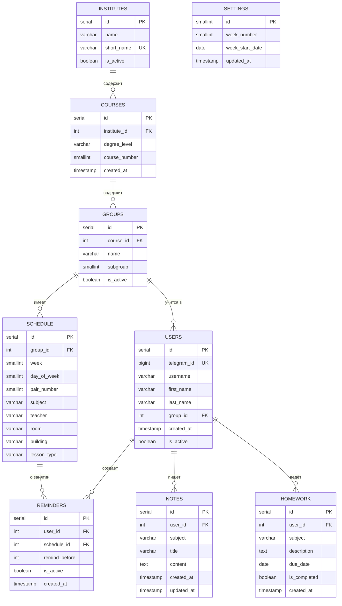

# Схема базы данных Telegram-Schedule-Bot

Документ описывает логическую модель данных бота: какие таблицы есть, какие
в них поля, как таблицы связаны и по каким правилам заполняется справочник
институтов, курсов и групп.

Документ закрывает задачи **1.4** (ER-диаграмма) и **1.5** (справочник
институтов, курсов и групп) и служит основой для задач **3.13** и **10.02**
(документация схемы БД): файл создаётся один раз, а задачи закрываются по мере
перехода к соответствующим эпикам.

СУБД — PostgreSQL 15+ (см. `docs/design/tech_stack.md`), драйвер подключения —
`asyncpg`, строка подключения зафиксирована в константах, К1. Доступ к данным —
через SQLAlchemy 2.0 в асинхронном режиме. Имена таблиц и столбцов записаны в
`snake_case`, как их примет ORM без дополнительных настроек.

## 1. Сущности

| Таблица | Назначение | Источник данных |
|---|---|---|
| `users` | пользователи Telegram-бота | регистрация в боте |
| `institutes` | институты СФУ | лист «Институты» Excel-файла |
| `courses` | курсы обучения внутри института | вычисляется по названию группы |
| `groups` | учебные группы и подгруппы | лист «Группы», шапка расписания |
| `schedule` | занятия в расписании | лист «Расписание» |
| `reminders` | напоминания о занятиях | создаёт пользователь |
| `notes` | личные заметки с привязкой к предмету | создаёт пользователь |
| `homework` | домашние задания с дедлайном | создаёт пользователь |
| `settings` | состояние учебного процесса | заполняется при загрузке архива |

Таблица `settings` нужна для одной конкретной вещи: бот должен знать, какая
учебная неделя идёт сейчас (первая или вторая) и с какого дня она началась.
Без этого невозможно выбрать половину расписания — в файлах СФУ занятия
заданы отдельно для чётной и нечётной недели.

## 2. Связи

| Связь | Тип | Смысл |
|---|---|---|
| `institutes` → `courses` | 1 : N | у института несколько курсов |
| `courses` → `groups` | 1 : N | у курса несколько групп |
| `groups` → `schedule` | 1 : N | у группы много занятий |
| `groups` → `users` | 1 : N | студент учится в одной группе (US-02) |
| `users` → `reminders` | 1 : N | пользователь создаёт напоминания |
| `schedule` → `reminders` | 1 : N | напоминание привязано к занятию |
| `users` → `notes` | 1 : N | пользователь пишет заметки (US-08) |
| `users` → `homework` | 1 : N | задания личные, не общие на группу (US-10) |

Связи «многие ко многим» между пользователями и группами нет: по US-02 у
студента ровно одна группа и одна подгруппа, смена группы заменяет значение,
а не добавляет второе.

## 3. Таблицы

### 3.1. `users` — пользователи бота

| Атрибут | Тип | Ограничения | Назначение |
|---|---|---|---|
| `id` | SERIAL | PK | внутренний идентификатор |
| `telegram_id` | BIGINT | UNIQUE, NOT NULL | идентификатор в Telegram |
| `username` | VARCHAR(255) | NULL | имя пользователя в Telegram |
| `first_name` | VARCHAR(255) | NULL | имя |
| `last_name` | VARCHAR(255) | NULL | фамилия |
| `group_id` | INTEGER | FK → `groups.id`, NULL | выбранная группа и подгруппа |
| `created_at` | TIMESTAMP | NOT NULL, DEFAULT NOW() | дата регистрации |
| `is_active` | BOOLEAN | NOT NULL, DEFAULT TRUE | пользователь не заблокировал бота |

`group_id` допускает `NULL`: сразу после `/start` пользователь ещё не выбрал
группу, и бот по US-01 обязан предложить выбор, а не показывать пустое
расписание.

### 3.2. `institutes` — институты СФУ

| Атрибут | Тип | Ограничения | Назначение |
|---|---|---|---|
| `id` | SERIAL | PK | идентификатор института |
| `name` | VARCHAR(255) | NOT NULL | полное название |
| `short_name` | VARCHAR(100) | UNIQUE, NOT NULL | аббревиатура (ИКИТ, ИМФИ) |
| `is_active` | BOOLEAN | NOT NULL, DEFAULT TRUE | институт действует |

`short_name` уникален: по нему строится кнопка выбора и он же приходит в
Excel-файле в строке «Институт:».

### 3.3. `courses` — курсы обучения

| Атрибут | Тип | Ограничения | Назначение |
|---|---|---|---|
| `id` | SERIAL | PK | идентификатор курса |
| `institute_id` | INTEGER | FK → `institutes.id`, NOT NULL | институт |
| `degree_level` | VARCHAR(20) | NOT NULL | уровень образования |
| `course_number` | SMALLINT | NOT NULL, CHECK 1–6 | номер курса |
| `created_at` | TIMESTAMP | NOT NULL, DEFAULT NOW() | дата создания |

Уровень образования (`degree_level`) принимает значения:

| Значение | Что означает | Пример группы |
|---|---|---|
| `bachelor` | бакалавриат | КИ24-03Б |
| `master` | магистратура | КИ26-01-10М |
| `specialist` | специалитет | КИ24-02 |

Ограничение уникальности: `UNIQUE(institute_id, degree_level, course_number)`.

Признак уровня обязателен, иначе «1 курс» неоднозначен: в одном институте
одновременно существуют первый курс бакалавриата и первый курс магистратуры,
и `UNIQUE(institute_id, course_number)` запретил бы второй. На примере ИКИТ
из `docs/design/group_hierarchy.md` это реальная ситуация, а не гипотетическая.

### 3.4. `groups` — учебные группы

| Атрибут | Тип | Ограничения | Назначение |
|---|---|---|---|
| `id` | SERIAL | PK | идентификатор группы |
| `course_id` | INTEGER | FK → `courses.id`, NOT NULL | курс |
| `name` | VARCHAR(100) | NOT NULL | название группы без подгруппы |
| `subgroup` | SMALLINT | NOT NULL, CHECK 1–2 | номер подгруппы |
| `is_active` | BOOLEAN | NOT NULL, DEFAULT TRUE | группа набиралась |

Ограничение уникальности: `UNIQUE(course_id, name, subgroup)`.

Одна учебная группа с двумя подгруппами хранится **двумя строками** с
одинаковым `name` и разным `subgroup`. Это позволяет хранить расписание
подгрупп независимо: у первой подгруппы английский, у второй — физкультура.
Если деления на подгруппы нет (группы `КИ24-03БС`, `КИ24-05БС` в расписании
ИКИТ), создаётся одна строка с `subgroup = 1`.

### 3.5. `schedule` — занятия

| Атрибут | Тип | Ограничения | Назначение |
|---|---|---|---|
| `id` | SERIAL | PK | идентификатор занятия |
| `group_id` | INTEGER | FK → `groups.id`, NOT NULL | группа и подгруппа |
| `week` | SMALLINT | NOT NULL, CHECK 1–2 | учебная неделя |
| `day_of_week` | SMALLINT | NOT NULL, CHECK 1–6 | день недели |
| `pair_number` | SMALLINT | NOT NULL, CHECK 1–8 | номер пары |
| `subject` | VARCHAR(255) | NOT NULL | дисциплина |
| `teacher` | VARCHAR(255) | NULL | преподаватель |
| `room` | VARCHAR(50) | NULL | аудитория |
| `building` | VARCHAR(100) | NULL | корпус |
| `lesson_type` | VARCHAR(50) | NULL | тип занятия |

Значения `week`: 1 — первая (нечётная), 2 — вторая (чётная).
Значения `day_of_week`: 1 — понедельник … 6 — суббота.
Значения `lesson_type`: `лекция`, `пр. занятие`, `лаб. работа`, `практика` —
ровно те, что предлагает Excel-файл СФУ.

Столбец `week` обязателен. В выгрузке расписания СФУ есть отдельный
столбец «Неделя», и одно и то же время в разные недели занято разными
предметами. Без этого поля бот выдаст обе пары одновременно.

`teacher`, `room`, `building` допускают `NULL`: в реальных файлах часть
занятий идёт без аудитории или без преподавателя.

### 3.6. `reminders` — напоминания

| Атрибут | Тип | Ограничения | Назначение |
|---|---|---|---|
| `id` | SERIAL | PK | идентификатор напоминания |
| `user_id` | INTEGER | FK → `users.id`, NOT NULL | пользователь |
| `schedule_id` | INTEGER | FK → `schedule.id`, NOT NULL | занятие |
| `remind_before` | INTEGER | NOT NULL, DEFAULT 15 | за сколько минут |
| `is_active` | BOOLEAN | NOT NULL, DEFAULT TRUE | напоминание включено |
| `created_at` | TIMESTAMP | NOT NULL, DEFAULT NOW() | дата создания |

Ограничение уникальности: `UNIQUE(user_id, schedule_id)` — у одного
пользователя не может быть двух напоминаний об одном занятии.

### 3.7. `notes` — заметки

| Атрибут | Тип | Ограничения | Назначение |
|---|---|---|---|
| `id` | SERIAL | PK | идентификатор заметки |
| `user_id` | INTEGER | FK → `users.id`, NOT NULL | автор |
| `subject` | VARCHAR(255) | NULL | предмет |
| `title` | VARCHAR(255) | NOT NULL | заголовок |
| `content` | TEXT | NOT NULL | текст заметки |
| `created_at` | TIMESTAMP | NOT NULL, DEFAULT NOW() | дата создания |
| `updated_at` | TIMESTAMP | NOT NULL, DEFAULT NOW() | дата изменения |

`subject` — строка, а не внешний ключ. По US-08 сценарию 2 предмета может не
быть в расписании, и тогда пользователь вводит его вручную; справочника
дисциплин в модели нет, поэтому ссылаться не на что.

### 3.8. `homework` — домашние задания

| Атрибут | Тип | Ограничения | Назначение |
|---|---|---|---|
| `id` | SERIAL | PK | идентификатор задания |
| `user_id` | INTEGER | FK → `users.id`, NOT NULL | владелец задания |
| `subject` | VARCHAR(255) | NOT NULL | предмет |
| `description` | TEXT | NOT NULL | описание задания |
| `due_date` | DATE | NULL | срок сдачи |
| `is_completed` | BOOLEAN | NOT NULL, DEFAULT FALSE | задание выполнено |
| `created_at` | TIMESTAMP | NOT NULL, DEFAULT NOW() | дата создания |

`due_date` допускает `NULL`: по US-10 сценарию 3 задание можно сохранить без
срока, бот помечает его как «без дедлайна».

### 3.9. `settings` — состояние учебного процесса

| Атрибут | Тип | Ограничения | Назначение |
|---|---|---|---|
| `id` | SMALLINT | PK, CHECK `id = 1` | строка всегда одна |
| `week_number` | SMALLINT | NOT NULL, CHECK 1–2 | текущая учебная неделя |
| `week_start_date` | DATE | NOT NULL | дата понедельника этой недели |
| `updated_at` | TIMESTAMP | NOT NULL, DEFAULT NOW() | когда меняли |

Таблица хранит ровно одну строку. Ограничение `CHECK (id = 1)` превращает это
намерение в правило, которое проверяет сама СУБД.

Текущая неделя вычисляется, а не вводится вручную: администратор один раз
указал дату начала и номер недели при загрузке архива, дальше бот считает
`((сегодня − week_start_date) // 7) % 2` и получает 1 или 2. Если файл
расписания поменялся на середине семестра, значения правятся в этой же строке.

Настройки не хранятся в `config.py`, потому что они меняются в течение
семестра. Файл конфигурации читается один раз при старте, и после правки
пришлось бы перезапускать бота.

## 4. Индексы

| Таблица | Индекс | Зачем |
|---|---|---|
| `schedule` | `(group_id, week, day_of_week)` | основной запрос: расписание группы на день |
| `schedule` | `(group_id, subject)` | список предметов для выбора в заметке |
| `groups` | `(course_id, name)` | поиск группы при выборе в боте |
| `users` | `(telegram_id)` | уникальный, поиск пользователя на каждом сообщении |
| `reminders` | `(user_id, is_active)` | выборка активных напоминаний |
| `homework` | `(user_id, due_date)` | сортировка заданий по сроку (US-11) |

Индекс `UNIQUE(telegram_id)` создаётся ограничением уникальности и отдельно
не дублируется.

## 5. Внешние ключи

| Таблица | Столбец | Ссылается на | При удалении |
|---|---|---|---|
| `courses` | `institute_id` | `institutes.id` | RESTRICT |
| `groups` | `course_id` | `courses.id` | RESTRICT |
| `schedule` | `group_id` | `groups.id` | CASCADE |
| `users` | `group_id` | `groups.id` | SET NULL |
| `reminders` | `user_id` | `users.id` | CASCADE |
| `reminders` | `schedule_id` | `schedule.id` | CASCADE |
| `notes` | `user_id` | `users.id` | CASCADE |
| `homework` | `user_id` | `users.id` | CASCADE |

`RESTRICT` в справочниках: нельзя удалить институт, пока в нём есть курсы.
`CASCADE` в пользовательских данных: удалили пользователя — его заметки и
напоминания больше не нужны. `SET NULL` для группы: студент остаётся в боте,
но без группы, и бот снова просит её выбрать.

## 6. Справочник институтов, курсов и групп

### 6.1. Откуда берутся данные

Институты, курсы и группы не вводятся вручную. Они появляются при загрузке
ZIP-архива с расписанием (US-12, эпик 4): парсер читает строку «Институт:»,
лист «Группы» и шапку расписания, и создаёт недостающие записи справочника.

Единственное исключение — файл `data/sample_groups.json`: фиксированный набор
данных для тестов, чтобы тесты не зависели от внешнего архива.

### 6.2. Как определяется курс

Название группы кодирует год набора: `КИ24-03Б` — набор 2024 года. Курс
считается по учебному году:

```
course_number = учебный_год − год_набора + 1
```

Для 2026/27 учебного года: `2026 − 2024 + 1 = 3` — третий курс. Правило
работает и для магистратуры: `КИ26-01-10М` — набор 2026 года, первый курс.

Год в названии — две цифры, поэтому 20 к названию приписывается: `24` → 2024.

### 6.3. Форматы названий групп

| Шаблон | Пример | Что означает |
|---|---|---|
| `КИ24-03Б` | бакалавриат | `КИ` — код института, `24` — год набора, `03` — номер, `Б` — бакалавриат |
| `КИ24-17/1Б` | группа с дробным номером | `/1` — первый поток из нескольких |
| `КИ24-10/1БГ` | гибридная группа | суффикс `Г` — смешанная, в расписании идёт одной колонкой |
| `КИ24-03БС` | сокращённая программа | суффикс `С` — ускоренное обучение, подгрупп нет |
| `ЗКИ24-16Б` | заочное отделение | префикс `З` — заочная форма |
| `КИ26-01-10М` | магистратура | `М` на конце, номер трёхчастный |

Парсер сохраняет название как есть, в поле `groups.name` — без подгруппы.
Подгруппа вырезается из шапки расписания, где она записана отдельно:
`КИ24-03Б (1 подгруппа)`.

Название группы уникально внутри курса, но не внутри института: `КИ24-01` и
`КИ25-01` — разные группы разных курсов, и это нормально.

### 6.4. Подгруппы

| Ситуация | Что делаем |
|---|---|
| в шапке есть «(1 подгруппа)» и «(2 подгруппа)» | две строки: `subgroup = 1` и `subgroup = 2` |
| колонка одна, без пометки | одна строка: `subgroup = 1` |
| группа указана только в листе «Группы», в расписании её нет | подгруппа неизвестна, используем `1` |

Третья ситуация в реальном файле встречается: `КИ24-10/1Б` и `КИ24-17/2Б`
есть в справочнике, но в осеннем расписании третьего курса их нет.

### 6.5. Фикстура для тестов

`data/sample_groups.json` содержит фрагмент справочника: ИКИТ, третий курс,
27 групп — ровно те, что присутствуют в шапке расписания ИКИТ за осенний
семестр 2026/27.

```json
{
  "institutes": [
    {
      "short_name": "ИКИТ",
      "name": "Институт космических и информационных технологий",
      "courses": [
        {
          "course_number": 3,
          "groups": [
            { "name": "КИ24-03Б", "subgroups": [1, 2] }
          ]
        }
      ]
    }
  ]
}
```

Формат повторяет структуру таблиц: `institutes` → `courses` → `groups`.
Поле `subgroups` — массив номеров подгрупп, при загрузке разворачивается в
отдельные строки `groups`.

В фикстуре нет уровней образования, потому что все 27 групп — бакалавриат.
При загрузке полного справочника поле `degree_level` определяется по
суффиксу названия: `М` — магистратура, `Б` — бакалавриат, без буквы —
специалитет.

## 7. Отличия от первоначального варианта схемы

Схема основана на документе, подготовленном в рамках задачи 1.5, и изменена
в четырёх местах. Каждое изменение продиктовано требованием, а не вкусом.

| Что | Было | Стало | Причина |
|---|---|---|---|
| учебная неделя | нет | `schedule.week` | в Excel расписание задано отдельно для 1-й и 2-й недели |
| состояние семестра | нет | таблица `settings` | бот не может определить текущую неделю |
| уровень образования | нет | `courses.degree_level` | «1 курс» в ИКИТ существует и в бакалавриате, и в магистратуре |
| группа пользователя | таблица `user_groups` (N:M) | `users.group_id` | по US-02 группа одна и заменяется, а не добавляется |
| группа у задания | `homework.group_id` | удалено | по US-10 задание личное, общее на группу не предусмотрено |
| предмет заметки | нет | `notes.subject` | по US-08 заметка привязана к предмету |
| день недели | `dayofweek` | `day_of_week` | единый `snake_case` для всех столбцов |

`user_groups` не ломала работу, но создавала возможность записать студента в
две группы одновременно, что противоречит US-02.

## 8. ER-диаграмма

Исходник: `docs/diagrams/er_diagram.drawio` (открывается в drawio и на
app.diagrams.net). Готовая картинка: `docs/diagrams/er_diagram.svg`.

Ниже та же диаграмма в формате Mermaid — GitHub рисует её прямо в документе,
не требуя открывать файл:



У `settings` нет связей: таблица хранит глобальное состояние бота и не
ссылается на другие таблицы.

## 9. Что сознательно не включено

| Сущность | Почему нет |
|---|---|
| `students`, `teachers` | бот не ведёт учёт людей: преподаватель хранится строкой в занятии, студент — это пользователь бота |
| справочник дисциплин | дисциплины приходят строками из Excel; при выборе предмета в заметке список строится запросом по `schedule` |
| справочник аудиторий и корпусов | аудитория хранится строкой; отдельная таблица нужна только для поиска свободных аудиторий, такой функции в требованиях нет |
| `import_files`, `import_errors` | журнал загрузок относится к эпику 4, модель появится вместе с парсером |
