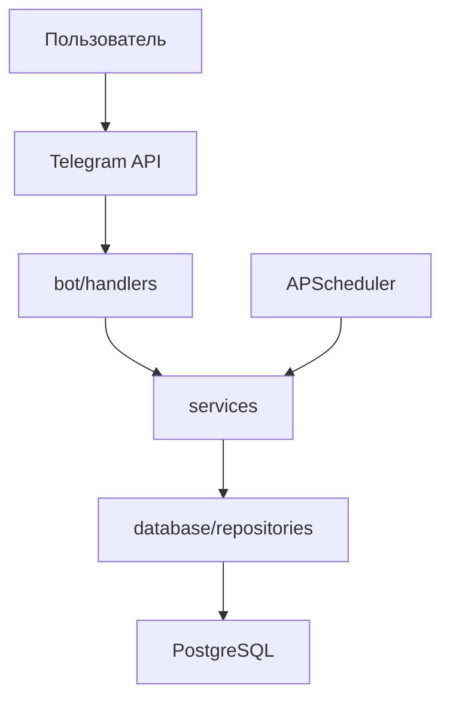

# Архитектура приложения "Telegram-бот расписания СФУ"

## Общий принцип

Проект использует слоистую архитектуру с разделением ответственности. Каждый слой решает свою задачу и взаимодействует только с соседними слоями. Это упрощает тестирование, поддержку и масштабирование кода.

## Структура папок

```
telegram-schedule-bot/
├── src/
│   ├── __init__.py
│   ├── main.py                        # Точка входа в приложение
│   ├── bot/                           # Слой представления (Presentation Layer)
│   │   ├── __init__.py
│   │   ├── handlers/                  # Обработчики команд и сообщений
│   │   │   ├── __init__.py
│   │   │   ├── start.py               # /start, /help, /mygroup, /cancel, регистрация
│   │   │   ├── schedule.py            # /schedule, /today, /week
│   │   │   ├── reminders.py           # /reminder, /reminders
│   │   │   ├── notes.py               # /note, /notes
│   │   │   ├── homework.py            # /homework, /homeworks, /deadlines
│   │   │   └── admin.py               # /upload_schedule, /set_week (только для админов)
│   │   ├── keyboards/                 # Клавиатуры (Reply и Inline)
│   │   │   ├── __init__.py
│   │   │   ├── main_menu.py           # Главное меню бота
│   │   │   └── inline_menus.py        # Inline-кнопки для выбора
│   │   ├── middlewares/               # Промежуточные обработчики
│   │   │   ├── __init__.py
│   │   │   ├── check_registration.py  # Проверка, выбрал ли пользователь группу
│   │   │   └── check_admin.py         # Проверка прав администратора
│   │   └── fsm_states/                # Состояния FSM для пошаговых диалогов
│   │       ├── __init__.py
│   │       └── states.py
│   ├── services/                      # Слой бизнес-логики (Business Logic Layer)
│   │   ├── __init__.py
│   │   ├── schedule_service.py        # Логика работы с расписанием
│   │   ├── reminder_service.py        # Логика напоминаний
│   │   ├── note_service.py            # Логика заметок
│   │   ├── homework_service.py        # Логика домашних заданий
│   │   └── notification_service.py    # Отправка массовых уведомлений
│   ├── parsers/                       # Парсинг расписания
│   │   ├── __init__.py
│   │   ├── excel_parser.py            # Чтение и парсинг Excel-файлов СФУ
│   │   ├── zip_handler.py             # Работа с ZIP-архивами
│   │   └── validators.py              # Валидация данных из Excel
│   ├── database/                      # Слой доступа к данным (Data Access Layer)
│   │   ├── __init__.py
│   │   ├── connection.py              # Подключение к PostgreSQL
│   │   ├── models/                    # SQLAlchemy-модели (таблицы БД)
│   │   │   ├── __init__.py
│   │   │   ├── user.py                # Модель пользователя
│   │   │   ├── institute.py           # Справочник институтов
│   │   │   ├── course.py              # Справочник курсов
│   │   │   ├── group.py               # Учебные группы
│   │   │   ├── schedule.py            # Расписание
│   │   │   ├── reminder.py            # Напоминания
│   │   │   ├── note.py                # Заметки
│   │   │   ├── homework.py            # Домашние задания
│   │   │   └── settings.py            # Настройки бота (текущая учебная неделя)
│   │   └── repositories/              # Функции запросов к БД
│   │       ├── __init__.py
│   │       ├── user_repo.py
│   │       ├── schedule_repo.py
│   │       └── ...
│   └── utils/                         # Вспомогательные функции
│       ├── __init__.py
│       ├── config.py                  # Загрузка настроек из .env и константы
│       ├── logger.py                  # Настройка логирования
│       └── helpers.py                 # Общие утилиты (форматирование времени и т.д.)
├── migrations/                        # Миграции БД, создаются командой alembic init (задача 2.2)
├── tests/                             # Тесты
│   ├── __init__.py
│   ├── test_parsers/
│   │   └── __init__.py
│   ├── test_handlers/
│   │   └── __init__.py
│   └── test_services/
│       └── __init__.py
├── docs/                              # Документация проекта
├── logs/                              # Логи бота (в git попадает только .gitkeep)
├── data/                              # Тестовые данные (в git попадает только .gitkeep)
├── .env.example                       # Пример файла с переменными окружения
├── .gitignore
├── .pre-commit-config.yaml            # Проверки перед коммитом (задача 2.10)
├── pyproject.toml                     # Настройки ruff (задача 2.10)
├── requirements.txt
└── README.md
```

Каждый каталог, содержащий Python-код, имеет `__init__.py` — без него импорт
вида `from src.services import ...` не работает, а pytest не различает одноимённые
тестовые модули из разных папок.

Файлы `__init__.py` и каталоги создаются в задаче 2.7. Из модулей на этом этапе
заводятся только три заготовки: `src/main.py`, `src/database/connection.py`,
`src/utils/config.py`. Остальные модули из дерева появляются в задачах эпиков 3–9;
пустые файлы заранее не создаются.

## Принцип взаимодействия слоёв

Поток запроса от пользователя выглядит так:
Пользователь -> Telegram API -> aiogram (bot/handlers) -> services -> database -> PostgreSQL


### Пример: Пользователь отправляет /today

1. Слой handlers (`bot/handlers/schedule.py`):
   - aiogram ловит команду `/today`
   - Middleware `check_registration` проверяет, выбрал ли пользователь группу
   - Handler извлекает `telegram_id` пользователя из сообщения
   - Вызывает функцию из слоя services: `await get_today_schedule(user_id)`
   - Получает готовые данные и форматирует их в текст
   - Отправляет ответ пользователю через Telegram API

2.*Слой services (`services/schedule_service.py`):
   - Получает `user_id`
   - Делает запрос в repository, чтобы узнать группу пользователя
   - Делает запрос в repository, чтобы получить расписание на сегодня для этой группы
   - Возвращает список пар в виде Python-объектов

3. Слой database (`database/repositories/schedule_repo.py`):
   - Выполняет SQL-запрос через SQLAlchemy: `SELECT * FROM schedule WHERE group_id = ? AND day_of_week = ?`
   - Возвращает результаты в виде объектов моделей

4. PostgreSQL:
   - Хранит данные и выполняет запрос

## Ключевые архитектурные решения

### 1. Роутеры по функциональным модулям
Handlers сгруппированы по функциям (schedule.py, reminders.py, notes.py), а не по типу событий. Это упрощает навигацию для новичков - вся логика расписания в одном файле.

### 2. FSM для пошаговых диалогов
Используем встроенный FSM из aiogram 3.x для:
- Добавления заметки (шаг 1: текст -> шаг 2: предмет -> шаг 3: сохранение)
- Добавления домашнего задания (шаг 1: описание -> шаг 2: предмет -> шаг 3: дедлайн)
- Управления напоминаниями

Состояния хранятся в памяти бота.

### 3. Middleware для проверок
Два middleware решают общие задачи:
- `check_registration`: если пользователь не выбрал группу, перенаправляем его на регистрацию
- `check_admin`: если пользователь не админ, блокируем доступ к командам `/upload_schedule` и `/set_week`

### 4. Отдельная папка parsers
Логика парсинга расписания СФУ сложная:
- Обработка объединённых ячеек
- Извлечение данных из многострочных ячеек (предмет/преподаватель/тип/корпус/аудитория)
- Игнорирование строк "Занятия для студентов, обучающихся по программам военной подготовки"
- Обработка подгрупп (1 подгруппа, 2 подгруппа)
- Разбор столбца «Неделя»: расписание задано отдельно для 1-й и 2-й учебной недели, пары могут различаться

Эта логика вынесена в отдельную папку `parsers/`, чтобы не смешивать с бизнес-логикой.

### 5. Раздельная конфигурация
- `.env` - секреты (токен бота, пароль БД, список админов)
- `config.py` - константы (названия кнопок, время напоминаний по умолчанию, максимальное количество пар)
- таблица `settings` в БД - то, что меняется без перезапуска бота (текущая учебная неделя и дата её начала)

### 6. Логирование
Используем стандартный модуль `logging`:
- Консоль: уровень INFO для продакшена, DEBUG для разработки
- Файл `logs/bot.log`: уровень INFO, ротация по размеру (10 МБ)

### 7. Тесты
Отдельная папка `tests/` с подпапками, повторяющими структуру `src/`:
- `tests/test_parsers/` - тесты парсинга Excel
- `tests/test_handlers/` - тесты handlers (с моками)
- `tests/test_services/` - тесты бизнес-логики

### 8. Зависимости между слоями
Прямые импорты (services импортируют repositories, handlers импортируют services). Dependency Injection не используется - это упрощает код для новичков. Если проект вырастет, можно добавить DI позже.

## Диаграмма компонентов



## Масштабируемость

Архитектура позволяет легко добавлять новый функционал:
- Новая функция (например, "отслеживание прогресса") = новый handler + новый service + новая модель в БД
- Изменение формата расписания = правка только `parsers/excel_parser.py`, остальной код не трогается
- Замена БД = правка только `database/connection.py` и моделей
- Добавление нового middleware = не требует изменения handlers

## Правила именования

- Файлы: snake_case (`schedule_service.py`)
- Классы: PascalCase (`ScheduleService`, `UserModel`)
- Функции: snake_case (`get_today_schedule()`)
- Константы: UPPER_SNAKE_CASE (`DEFAULT_REMINDER_TIME`)
- Переменные: snake_case (`user_id`, `group_name`)
